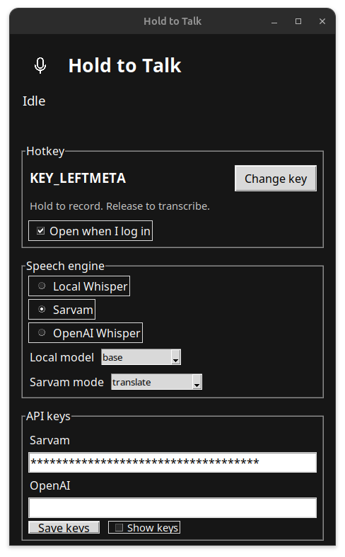

# wisprflow-linux




Hold a key to record the microphone. Release it to transcribe.

The app in the window is **Hold to Talk**. This repo is an independent Linux dictation tool. It is not Wispr Flow.

- If a text field is focused, the transcript is inserted there with the Linux accessibility API (AT-SPI).
- If nothing editable is focused, the transcript is copied to the clipboard.

A small on-screen indicator shows Listening, then Transcribing.

The logo is the [Phosphor](https://phosphoricons.com) microphone icon.

```bash
./run.sh
```

First launch creates a venv and installs `evdev` and `faster-whisper`. The local Whisper model downloads the first time you use that engine.

Settings are saved to `~/.config/panda-hold-to-talk/config.json` (mode 600).

The first run also turns on login autostart, so it opens when you sign in. Uncheck **Open when I log in** to stop that. That same launch writes the app menu entry, using the Phosphor logo.

## Engines

- **Local Whisper** — `tiny`, `base`, `small`, or `medium` on CPU. No key.
- **Sarvam** — [Saaras v3](https://api.sarvam.ai/speech-to-text). Paste an API key. Default mode is `transcribe`.
- **OpenAI Whisper** — `whisper-1` at `api.openai.com`. Paste an API key.

## Hotkey

The default key is Fn (`KEY_FN`). A lot of laptop firmware never sends Fn to Linux. If holding Fn does nothing, use **Change key** and press another key (Esc cancels).

The listener reads `/dev/input` and only reacts to the chosen key. It does not grab the keyboard, so the key still reaches other apps.

## Requirements

- `parec` (PipeWire or PulseAudio)
- `python3-gi` and `gir1.2-atspi-2.0`
- `wl-copy` or `xclip` for the clipboard path
- Read access to `/dev/input/event*` (`sudo usermod -aG input $USER`, then log in again, if the keys never fire)
